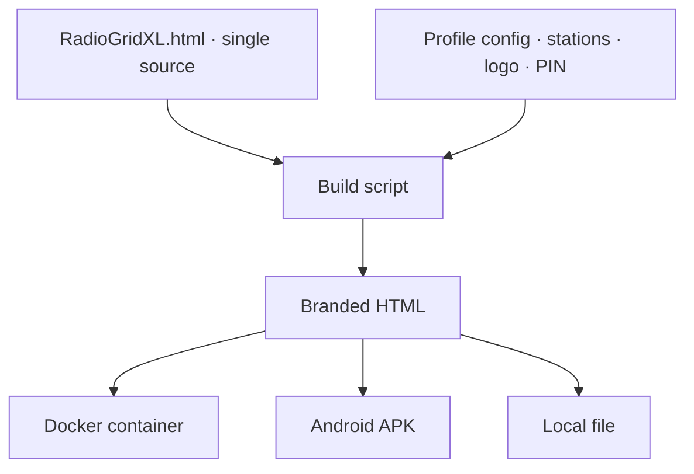

RadioGridXL is an internet radio app built for older adults and people with disabilities. Big buttons, no account, no ads, nothing to set up. I built it as a single HTML file with no dependencies, no build step, and no backend, and it's deployed at the nonprofit where I'm the Director of Technology, for people who just want to listen to something without fighting the interface.

## The interface

Big buttons, one per station. Tap to play, tap again to pause. The default dark theme keeps the focus on the station buttons - each one gets an emoji icon, a color, and a subtitle. The layout measures available viewport space and calculates button sizing dynamically, filling the screen whether there's one station or eight.

Add more stations and the layout shifts to a grid: two columns on a phone, up to four on a wide screen, with the first station spanning the top row when the count is odd. Each station gets its own color from eight palettes. No media query breakpoints - the grid math is pure viewport calculation.

## Playback and controls

When a station is playing, the interface shifts - the active button highlights, a connection dot in the header turns green, and the transport bar lights up. There are two control modes. Simple gives you a single stop button. Advanced adds station skip and a sleep timer, and splits stopping into two actions - a soft Pause that holds the stream so you can resume where you left off, and a full Stop. The transport icons are inline SVG rather than unicode glyphs, so iOS can't swap in its own skeuomorphic emoji versions. Wake Lock keeps the screen on during playback. Auto-retry handles dropped connections with up to four attempts before showing an error.

## Technician settings

Five taps on the logo opens a PIN-protected settings panel - hidden enough that no one's found it by accident yet. A technician can configure everything without exposing that complexity to the end user - theme, text size, volume cap, control mode, accessibility features, and the station list itself. Lockout escalates after failed PIN attempts.

## Stream browser

The stream browser searches the Radio Browser API by name, country, or genre. Preview a station before adding it. Pick an emoji icon and color theme per station.

## Accessibility

I designed for older adults and people with disabilities from the start, and it shaped the architecture:

- Eight color palettes held to WCAG AA contrast in every state, checked by a test that reads the colors straight from the app
- A High Contrast theme (shown above) held to AAA: black, white and yellow, text at 7:1, and a playing station filled solid yellow. The Low Vision preset uses it
- MonoRadio, a quieter greyscale theme, and Night, dim amber with no blue for a bedside radio
- Full screen reader support - ARIA roles, labels, and live regions throughout
- Optional text-to-speech that announces playback actions via the Web Speech API
- Audio chimes on play/pause using Web Audio API oscillators
- Haptic feedback on mobile devices
- Keyboard navigation with focus trapping in overlays
- An "Ultra" size mode that scales with viewport dimensions for low vision users
- Simple and Advanced transport modes to control cognitive load

## How it's built

One HTML file. Around 6,000 lines of vanilla HTML, CSS, and JavaScript. Not how anyone would recommend structuring an app, but the constraints justified it. Zero external dependencies. Copy the file to a device, open it in a browser, it works.

A profile system supports branded variants - a build script swaps in custom station lists, logos, and PINs for different deployments. The Lighthouse Center deployment runs as a Docker container. There's also an Android APK build path using Gradle.

## Updates

### 2026-10-26
Released v7.13.0. In settings, Preview shows the station grid with your changes before you apply them, and the grid can't be used while it's showing, so a tapped station used to do nothing with no sign why. Now that tap brings up "Preview only. Tap Back to settings to make changes." for a few seconds, and the Back to settings button pulses so it's easy to find. Screen readers hear the message too.

Released v7.12.1, fixing the app on iPhones with a notch. Installed on the home screen, the app draws under the status bar, and the top of settings, with its Preview and close buttons, sat under it where a tap couldn't reach. Settings now starts below the status bar and keeps those buttons pinned while it scrolls. The help sheet got the same fix. With the phone sideways, the logo, the outer station buttons and the sleep timer now keep clear of the notch.

Released v7.12.0 with a new logo: an R built from rounded tiles, like the station buttons, shading from cyan to violet, with radio waves on both sides. It follows the theme, turning grey in MonoRadio, white and yellow in High Contrast and amber in Night, and every part of it holds 3:1 contrast against the header. The browser tab shows the R by itself, drawn on whole pixels so it stays sharp at 16px.

Released v7.11.0. When a row has room for a station's name but not its description, as on a phone turned sideways, the button keeps its icon as long as the icon costs the name no more than 15% of its size. The icon is how someone who doesn't read finds a station.

Released v7.10.1. Six to eight stations used to drop their names and show only their icons on every screen, a large tablet included. Now they show names wherever a row has the room, and fall back to icons only on a screen too small for words.

Released v7.10.0 with a Night theme for a radio by the bed: black and dim amber with no blue anywhere, text just over the WCAG AA line so it reads without lighting the room. The flash on a tap, the emoji and the overlay icons dim with it. A web page can't turn down the backlight, so on an LCD the black still glows a little.

Released v7.9.0 with a High Contrast theme for low vision: black, white and yellow, every word at 7:1 contrast (WCAG AAA), and a playing station filled solid yellow. The Low Vision preset now uses it. MonoRadio buttons got a visible edge, since every station there shares one background. Earlier the same day, v7.8.0 added a Preview button to settings, so on a phone you can see a theme or station change before applying it, and v7.8.1 added a note to listen to a station before setting it up for someone else. The screenshots on this page now come from the app itself, retaken with each release.

Released v7.7.0, the result of an audit of the whole app. A paused or stopped radio now stays silent through Wi-Fi drops, retries and relaunches, because a station coming back on its own at night could wake someone. Auto-Resume only restarts a station that was playing when the app closed. Playing, paused and failed stations meet WCAG AA contrast in every theme, the sleep timer stops chattering to screen readers, and Ultra is now the largest text size on every screen. When a live station drops or stalls, the app reconnects quietly and fades back in. On the web, the station browser only lists stations it can play.

### 2026-10-20
Added a how-to guide (v7.6.0). Its steps run as tests against the real app, so a change that breaks a step fails the build, and its screenshots are captured from the app itself. The app's settings open it in an overlay, and this page links to it.

### 2026-05-29
Synced the live demo to v7.5.5, which adds the Pause/Stop split in Advanced mode and the inline SVG transport icons. v7.5.2 re-centered the logo and regenerated the maskable PWA icons, since the home-screen mark was getting cropped off-center on add-to-home-screen.

### 2026-05-28
Updated the live demo to v7.5.1. The big addition since launch is a PWA shell - installable, with lock-screen audio controls (MediaSession), auto-resume, and offline app-shell caching via a service worker. Also added backup/restore of settings, accessibility presets, and per-stream loudness leveling so stations don't jump in volume. The demo moved from `/radio.html` to `/radio/` so the service worker stays scoped to its own directory instead of the whole site.

### 2026-04-26
Shipped and deployed. The profile system needs a web-based editor so other organizations can create branded deployments without touching code. Also looking at Service Worker caching for unreliable networks.
