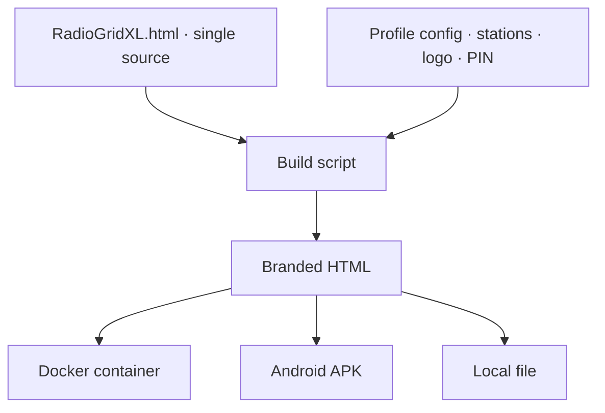

RadioGridXL is an internet radio app built for older adults and people with disabilities. Big buttons, no account, no ads, nothing to set up. I built it as a single HTML file with no dependencies, no build step, and no backend, and it's deployed at the nonprofit where I'm the Director of Technology, for people who just want to listen to something without fighting the interface.

## The interface

Big buttons, one per station. Tap to play, tap again to pause. The default dark theme keeps the focus on the station buttons - each one gets an emoji icon, a color, and a subtitle. The layout measures available viewport space and calculates button sizing dynamically, filling the screen whether there's one station or eight.

Add more stations and the layout shifts to a grid: two columns on a phone, up to four on a wide screen, with the first station spanning the top row when the count is odd. Each station gets its own color from eight palettes. No media query breakpoints - the grid math is pure viewport calculation.

## Playback and controls

When a station is playing, the interface shifts - the active button highlights, a connection dot in the header turns green, and the transport bar lights up. There are two control modes. Simple gives you a single stop button. Advanced adds station skip and a sleep timer, and splits stopping into two actions - a soft Pause that holds the stream so you can resume where you left off, and a full Stop. The transport icons are inline SVG rather than unicode glyphs, so iOS can't swap in its own skeuomorphic emoji versions. Wake Lock keeps the screen on during playback. Auto-retry handles dropped connections with up to four attempts before showing an error.

## Technician settings

Five taps on the logo opens a PIN-protected settings panel - hidden enough that no one's found it by accident yet. A technician can configure everything without exposing that complexity to the end user - theme, text size, volume cap, control mode, accessibility features, and the station list itself. Lockout escalates after failed PIN attempts.

## Stream browser

The stream browser opens on six shelves of stations I picked: Calm & easy, Oldies, Classical, Jazz, News & talk, and Sleep. A script plays every one of them before each release. Past the shelves, it searches the Radio Browser API by name, country, state or region, and mood: Relaxing, Upbeat, Oldies, Classical, Jazz, Country, News & talk, Sports or Faith. Preview a station before adding it. A station arrives with a short name, an icon for its kind of music, a one-line description and a color no other station has, and any of them can be changed.

## Accessibility

I designed for older adults and people with disabilities from the start, and it shaped the architecture:

- Eight color palettes held to WCAG AA contrast in every state, checked by a test that reads the colors straight from the app
- A High Contrast theme (shown above) held to AAA: black, white and yellow, text at 7:1, and a playing station filled solid yellow. The Low Vision preset uses it
- MonoRadio, a quieter greyscale theme, and Night, dim amber with no blue for a bedside radio
- Full screen reader support - ARIA roles, labels, and live regions throughout
- Optional text-to-speech that announces playback actions via the Web Speech API
- Audio chimes on play/pause using Web Audio API oscillators
- Haptic feedback on Android
- Keyboard navigation with focus trapping in overlays
- An "Ultra" size mode that scales with viewport dimensions for low vision users
- Simple and Advanced transport modes to control cognitive load

## How it's built

One HTML file. Around 8,000 lines of vanilla HTML, CSS, and JavaScript. Not how anyone would recommend structuring an app, but the constraints justified it. Zero external dependencies. Copy the file to a device, open it in a browser, it works.

A profile system supports branded variants - a build script swaps in custom station lists, logos, and PINs for different deployments. The Lighthouse Center deployment runs as a Docker container. There's also an Android APK build path using Gradle.

## Updates

### 2026-11-05
Released v7.17.0, a reorganised settings panel: four groups (Stations, Look, Sound and controls, Setup), one tappable row per station, switches for voice and tones, theme swatches that look like station buttons, and an Apply button pinned to the bottom. Every saved setup loads exactly as before. Pausing live radio now lets go of the stream and resuming reconnects at the live point, which fixes stations getting stuck on iPhone after a quick pause and play.

Released v7.16.0 after walking every setting on a simulated iPhone, an iPhone SE and an iPad, and fixing the thirty things that tripped me up. A thick ring now marks the playing station, Pause and Stop have labels, the sleep timer gained 60 minutes and a Cancel button, Apply refuses a broken station address, and removing a station offers Undo. Haptics only ever worked on Android, so on iPhone and iPad that setting is greyed out with the reason.

### 2026-10-28
Released v7.15.3. Add station opens on its title with the keyboard down, so on a phone you see the shelves first and tap the search box when you want it.

### 2026-10-26
Fourteen releases in one day, v7.7.0 through v7.15.2. The ones that matter:

- High Contrast, held to AAA with the playing station solid yellow, and Night, dim amber with no blue for a bedside radio
- A new logo that follows the theme
- A station browser that opens on six hand-picked shelves, with state and region search and mood chips
- Added stations arrive with an icon, a cleaned-up name, a plain description and a color of their own
- A whole-app audit: a paused or stopped radio stays silent through Wi-Fi drops and relaunches, so nothing comes back on its own at night

Smaller fixes covered the iPhone notch, a hint when you tap a station in Preview, and a fade-in that kept climbing through a pause. The screenshots on this page now come from the app itself, retaken with each release.

### 2026-10-20
Added a how-to guide (v7.6.0). Its steps run as tests against the real app, so a change that breaks a step fails the build.

### 2026-05-29
Synced the live demo to v7.5.5: the Pause/Stop split in Advanced mode, inline SVG transport icons, and a re-centered home-screen icon.

### 2026-05-28
Updated the live demo to v7.5.1. It's now an installable PWA with lock-screen controls, auto-resume, offline caching, settings backup, accessibility presets and per-station loudness leveling. The demo moved from `/radio.html` to `/radio/` to keep the service worker scoped.

### 2026-04-26
Shipped and deployed.
