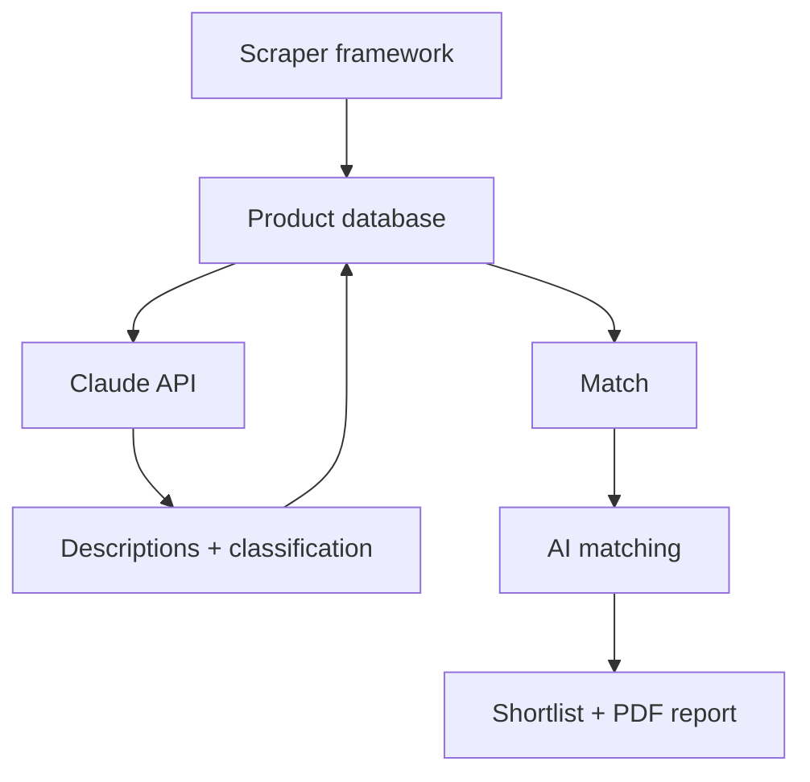

I'm the Director of Technology at Lighthouse Center for Vital Living, a nonprofit in Duluth that serves people with disabilities and older adults. Part of that job is assistive technology: evaluating devices, setting them up for clients, running an AT lending library, and answering colleagues' questions about what works. WhatCanHelp started from a question I kept coming back to: what would it look like if the AT industry had better discovery tools?

It's a free site with thousands of assistive technology products from hundreds of manufacturers in one place. You can browse the catalog, or describe a situation and get a shortlist. It also points you to the free programs in your state that lend devices and help pay for them. No account, no cookies, no ads, no affiliate links.

## Describe the situation

The home page leads with a search box. Under it, "Not sure? Describe your situation instead" opens Match, which is still marked Beta. Match starts with one text box: who it's for, what they're trying to do, what's in the way, any constraints. An AT specialist might write "58yo post-CVA, R-hemiparesis, returning to work; needs one-handed Windows input and voice control." A parent might write "my 8-year-old has trouble communicating at school." Both go through the same matching, and both get a shortlist with a note on why each product is on it.

I tried a structured checkbox flow first. It looked tidy, but the situations people brought me never fit the boxes. Now people write it the way they'd say it, and Claude pulls out the structure on the backend. What they type goes to Anthropic's API, which doesn't train on it, and isn't stored on the server.

## The catalog

The catalog filters by what a product helps with, product type, platform, how hard it is to set up, price, age group, manufacturer and funding source. Search understands plain descriptions as well as product names, so "help hearing the TV" finds TV listening systems. Results show as a table or as cards, and a filtered view can be shared as a link or exported as CSV.

## How hard is it to set up?

Every product gets one of four tiers:

| Tier | Meaning |
|---|---|
| **Ready to use** | Works on its own with no setup or training |
| **Setup with instructions** | Some configuration needed, but a tutorial gets you there |
| **Professional guidance helps** | You can start alone, but a pro gets much better results |
| **Professional setup required** | Needs professional assessment and configuration |

Whether someone, or the people around them, can set a device up and keep it working matters as much as whether it fits the need. So the tier appears next to every match, on every product page and in the report. Products in the higher tiers point to RESNA's AT Professional Finder, ASHA ProFind and the state AT Act program.

## Product pages

Each product page leads with price, manufacturer, setup tier and when the entry was last checked. Where a manufacturer doesn't publish a price, the page shows an estimated range and says so. The summary is written by Claude from the manufacturer's published material and stored, not generated on each visit, and it's labeled as AI-generated. Descriptions aim for about an 8th-grade reading level, and AT terms link to the glossary.

## Glossary

The glossary has more than 130 plain-language definitions, from AAC and switch access to funding programs and credentials like ATP and CLVT. Clicking a term opens a side drawer instead of a new page, and the link to an open term can be shared. Each term page also lists catalog products that use the term. That lookup matches whole words, so OT doesn't match "robot," and it ranks products named for the term above ones that only mention it.

## Borrowing and funding

Every US state and territory has a federally funded AT Act program, and most lend devices for a few weeks, free or close to it. Trying a device for a month is a much better basis for a decision than a product listing. The borrow directory lists all 56 programs with a phone number, a website and the date each listing was last verified.

The funding pages cover the same 56. Each one opens with the AT Act program, then Medicaid, Vocational Rehabilitation, AT financing loans and ABLE accounts, with what each program does and questions to ask when you call. They're starting points, not coverage advice. The same data feeds the "How to fund this" panels on product pages and the funding section of the PDF report.

## Guides and reports

Getting AT is usually a sequence: understand the options, borrow before buying, narrow the list, line up funding, and bring it to the right meeting. The guides walk that sequence for one kind of need at a time. There are nine now, from communication devices to sensory regulation.

The PDF report collects a summary of the situation, the matched products with explanations, their setup tiers and the funding programs that apply. It's meant to go into a funding packet or an IEP, or to hand to a family. It's tagged for screen readers, and it cites the WhatCanHelp and manufacturer pages, never a paid link.

## Accessibility

The settings menu covers theme, an increased-contrast mode, text size, line spacing and reduced motion. The site aims for WCAG 2.2 AA, and automated accessibility checks run on key pages with every change. Screen-reader testing is the main open item: VoiceOver testing of the core flows is under way, with NVDA, JAWS and TalkBack after that. The [accessibility statement](https://whatcanhelp.com/accessibility) lists what's still open.

## How it's built

Node.js and Express, SQLite, and plain JavaScript in the browser. The Anthropic API writes product descriptions, classifies products and runs Match. Product data comes from a scraper framework that reads manufacturer and retailer sites, hashes each page to spot changes, and refreshes the oldest entries first.

Products are tagged across seven dimensions: need, product type, platform, setup tier, price band, funding eligibility and age range. A product can sit under several needs without being duplicated.

## Updates

### 2026-09-17
The state funding pages got a rework. Each of the 56 now opens with the state's AT Act program, because that is the one call most people should make first: the staff lend devices, demonstrate them, and know which of the other programs fit. Medicaid, Vocational Rehabilitation, AT financing loans and ABLE follow, each with a plain-language summary, a phone number, TTY where the program publishes one, and questions to ask when you call. Listings are compiled from official program sites, the AT3 Center directory and the ABLE National Resource Center, and each shows when it was last verified. The index is at [whatcanhelp.com/funding](https://whatcanhelp.com/funding).

### 2026-06-15
Three additions around the core recommendation: borrowing, funding, and guided journeys. A borrow directory maps all 56 state and territory AT Act lending programs, so people can try a device before buying it. A funding directory maps the Medicaid, Vocational Rehabilitation, AT Act loan, and ABLE routes for the same 56 jurisdictions, and now drives "How to fund this" panels on products and a funding section in every PDF report. Step-by-step journey guides walk one kind of need (communication, vision, hearing, mobility) through the whole sequence, linking the glossary, lending programs, intake, funding, and report. The catalog grew to 5,502 products across 350+ manufacturers. Under the hood: an accessibility axe-gate across two dozen surfaces, 'unsafe-inline' dropped from the script CSP, an SSRF guard on scraped images, an AI kill switch with per-pool budgets, and daily database backups with a tested restore.

### 2026-05-25
Pivoted toward a professional audience (AT specialists, SLPs, OTs, educators) without losing the family-and-self-advocate doorway. Intake collapsed from a multi-step checkbox flow into one freeform "Describe the situation" textarea. Catalog grew to 5,060 products from 23 vendors. Detail pages added price, shortlist + share buttons, and a professional-finder callout pointing to RESNA, ASHA ProFind, and State AT Act Programs. Glossary gained a peek drawer with shareable URLs and a reverse "products that use this term" lookup on term pages. Blog posts now ship with hero images and inline product hover previews. Fresh screenshots throughout.

### 2026-05-09
Live at WhatCanHelp.com. 3,600+ products from 20 vendors browsable with faceted filters, guided intake, PDF reports, glossary, blog, and accessibility controls. Fresh screenshots and project page revision to match the shipped product.

### 2026-04-26
Project page is up. Still in active development - current focus is data cleanup, normalizing product records and testing the intake matching pipeline. Exploring when to publish publicly.
